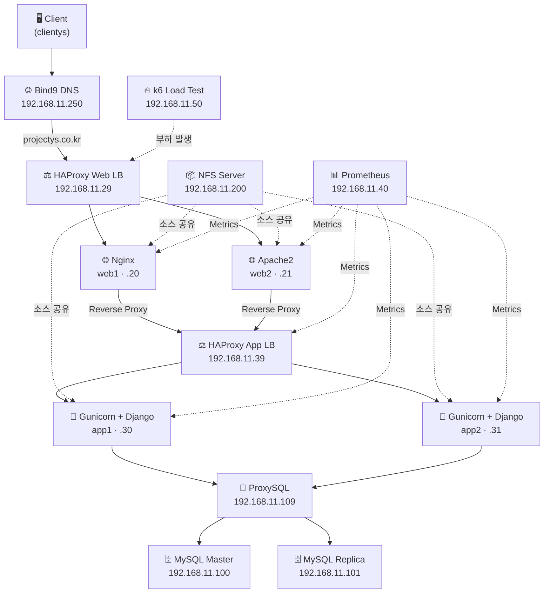

# 🏗️ On-Premise 3-Tier Web Infrastructure

> VMware + Vagrant로 구축한 **실운영형 On-Premise 3-Tier Architecture** 포트폴리오 프로젝트

[](#)
[](#)
[](#)
[](#)

---

## 📌 한 줄 소개

단순 웹 서버 구축을 넘어, **DNS · Load Balancer · Web · App · DB · Storage · Monitoring · Load Test**까지 포함한  
On-Premise 3-Tier 인프라를 **직접 설계·구축·운영**한 클라우드 엔지니어 포트폴리오 프로젝트입니다.

---

## 🎯 프로젝트 목적

이 프로젝트는 **"실제 서비스 운영 구조를 직접 설계하고 구축하며, 장애를 분석하고 해결하는 경험"** 을 목표로 합니다.

단순히 애플리케이션을 실행하는 것이 아니라, 아래와 같은 **운영 환경에 가까운 인프라 전체**를 구성했습니다.

| 영역 | 구현 내용 |
|------|-----------|
| IaC | Vagrant 기반 VM 자동 프로비저닝 |
| Network | Bind9 DNS, Private Network (`192.168.11.0/24`) |
| Web Tier | Nginx + Apache2 (이기종 웹 서버) |
| Load Balancing | HAProxy (Web LB / App LB) |
| App Tier | Django + Gunicorn (WSGI) |
| DB Tier | MySQL Master / Replica + ProxySQL |
| Storage | NFS 공유 스토리지 |
| Container | Docker Compose (Nginx + Django) |
| Monitoring | Prometheus + Exporter |
| Load Test | k6 부하 테스트 + Slack 알림 |

---

## ✨ 프로젝트 특징

- 🔧 **Infrastructure as Code** — `Vagrantfile` 하나로 14대 VM 정의
- ⚖️ **2단계 Load Balancing** — Web LB → App LB → App Server
- 🌐 **DNS 기반 서비스 디스커버리** — `projectys.co.kr` 도메인으로 내부 통신
- 📦 **NFS 공유 스토리지** — Web/App 소스 코드 중앙 관리
- 📊 **Prometheus 모니터링** — Node / Nginx / Apache Exporter 수집
- 🚀 **k6 부하 테스트** — 최대 1,000 VU, Slack Webhook 연동
- 🐳 **Docker 대안 배포** — VM 외 컨테이너 기반 배포 구성 포함
- 🔄 **간이 오토스케일링** — CPU 임계값 기반 `web2` VM 자동 기동 (`auto_scale.sh`)

---

## 🏛️ 프로젝트 아키텍처

### 아키텍처 다이어그램

> 📸 **아래 위치에 아키텍처 이미지를 삽입하세요**
>
> `docs/images/architecture.png`

<!-- 
추천: draw.io / Excalidraw로 작성 후 docs/images/ 에 저장
-->



### 트래픽 처리 흐름 (단계별)

| Step | 구간 | 처리 내용 |
|:----:|------|-----------|
| **1** | Client → Bind9 | `projectys.co.kr` DNS 조회 → Web LB IP(`192.168.11.29`) 반환 |
| **2** | Bind9 → HAProxy (Web LB) | Web Tier 진입점. `web1` / `web2`로 **Round Robin** 분산 |
| **3** | Web LB → Web Server | **web1(Nginx)**, **web2(Apache2)** 가 Reverse Proxy 역할 수행 |
| **4** | Web Server → HAProxy (App LB) | 동적 요청을 App LB(`192.168.11.39`)로 전달 |
| **5** | App LB → Gunicorn | **app1 / app2** 의 Django WSGI 프로세스(`:8000`)로 로드밸런싱 |
| **6** | Gunicorn → ProxySQL | DB LB(`192.168.11.109`)를 통해 MySQL 접근 *(Django 설정은 `db1` 직접 연결)* |
| **7** | ProxySQL → MySQL | Master(`192.168.11.100`) / Replica(`192.168.11.101`) 라우팅 |

> **📝 참고:** `conf_files/django/settings.py` 에서 Django는 `db1.projectys.co.kr`로 **직접 연결**합니다.  
> ProxySQL VM은 Vagrantfile에서 프로비저닝되며, DB LB 역할을 위한 인프라로 구성되어 있습니다.

---

## 🖥️ VM 구성

| VM 이름 | Hostname | IP | 역할 | 주요 서비스 |
|---------|----------|-----|------|-------------|
| `clientys` | clientys | `10.10.10.10` | 클라이언트 (Windows) | RDP 클라이언트 |
| `dns_server` | dns | `192.168.11.250` | DNS | Bind9 |
| `web_lb` | web-lb | `192.168.11.29` | Web Load Balancer | HAProxy |
| `web1` | web1 | `192.168.11.20` | Web Server | Nginx, NFS Client |
| `web2` | web2 | `192.168.11.21` | Web Server | Apache2, NFS Client |
| `app_lb` | app-lb | `192.168.11.39` | App Load Balancer | HAProxy |
| `app1` | app1 | `192.168.11.30` | App Server | Python venv, Gunicorn, NFS Client |
| `app2` | app2 | `192.168.11.31` | App Server | Python venv, Gunicorn, NFS Client |
| `db_lb` | db-lb | `192.168.11.109` | DB Load Balancer | ProxySQL 3.0.x |
| `db_master` | db-master | `192.168.11.100` | DB Master | MySQL 8.0 |
| `db_replica` | db-replica | `192.168.11.101` | DB Replica | MySQL 8.0 |
| `nfs` | nfs | `192.168.11.200` | 공유 스토리지 | NFS Kernel Server |
| `prometheus` | prometheus | `192.168.11.40` | 모니터링 | Prometheus 3.7.1 |
| `k6` | k6 | `192.168.11.50` | 부하 테스트 | k6 v0.45.1 |
| `projectcontainer` | projectcontainer | `192.168.11.150` | Docker Host | Docker CE, Compose |

### DNS 레코드 (`projectys.co.kr`)

| 레코드 | IP | 설명 |
|--------|-----|------|
| `@` | `192.168.11.29` | 루트 도메인 → Web LB |
| `weblb` | `192.168.11.29` | Web Load Balancer |
| `applb` | `192.168.11.39` | App Load Balancer |
| `dblb` | `192.168.11.109` | DB Load Balancer |
| `web1` / `web2` | `.20` / `.21` | Web Server |
| `app1` / `app2` | `.30` / `.31` | App Server |
| `db1` / `db2` | `.100` / `.101` | MySQL Master / Replica |
| `dns` | `192.168.11.250` | DNS Server |

---

## 🛠️ 기술 스택

| 분류 | 기술 |
|------|------|
| **Infrastructure** | On-Premise, Private Network (`192.168.11.0/24`) |
| **Virtualization** | VMware Desktop + Vagrant 2.x |
| **OS** | Ubuntu 22.04 LTS, Windows 11 (Client) |
| **Network** | Bind9 DNS, HAProxy, Private IP |
| **Web Server** | Nginx (web1), Apache2 (web2) |
| **Application Server** | Gunicorn (WSGI), Django 4.2.7 |
| **Database** | MySQL 8.0 (Master / Replica) |
| **Load Balancer** | HAProxy (Web/App), ProxySQL 3.0 (DB) |
| **Storage** | NFS (Kernel Server) |
| **Monitoring** | Prometheus 3.7.1, Node Exporter, Nginx/Apache Exporter |
| **Load Test** | k6 v0.45.1, Slack Webhook |
| **Container** | Docker CE, Docker Compose |
| **IaC** | Vagrant (Ruby) |
| **Version Control** | Git |
| **부가 앱** | Spring Boot 3.x (`arch1/`) — 별도 3-Tier Java 스택 *(참고용)* |

---

## ⚙️ 주요 기능

| 구성 요소 | 설명 |
|-----------|------|
| **Bind9 DNS** | `projectys.co.kr` 내부 도메인 관리, Forward/Reverse Zone 구성 |
| **HAProxy (Web LB)** | Web Tier(`web1`, `web2`) Round Robin 로드밸런싱, Stats 페이지(`:8080/state`) |
| **Nginx Reverse Proxy** | web1에서 `/` 요청을 App LB(`192.168.11.39`)로 프록시, `/nginx_status` 제공 |
| **Apache Reverse Proxy** | web2에서 `/` 요청을 App LB로 프록시, `/static/` 정적 파일 직접 서빙 |
| **HAProxy (App LB)** | app1/app2 Gunicorn(`:8000`) 헬스체크 + Round Robin 분산 |
| **Gunicorn WSGI** | Django WSGI 앱 실행, Worker 3개, systemd 서비스 등록 |
| **Django** | 커뮤니티 게시판 (`user_auth`, `attendance` 앱), MySQL 연동 |
| **ProxySQL** | MySQL Read/Write 분산을 위한 DB Load Balancer |
| **MySQL Replication** | Master(`db1`) / Replica(`db2`) 이중화 구성 |
| **NFS 공유** | `/nfs/web_source`, `/nfs/app_source` — Web/App 소스 중앙 배포 |
| **Prometheus** | 14개 VM Node Exporter + Nginx/Apache Exporter 메트릭 수집 |
| **k6 부하 테스트** | Stage 기반 VU 증가(200→1000), p95 < 500ms 임계값 설정 |
| **Docker Compose** | Nginx + Django 컨테이너 대안 배포 (`projectcontainer` VM) |
| **Auto Scale** | CPU 80% 초과 시 `web2` VM 자동 기동 스크립트 |

---

## 🚀 프로젝트 실행 방법

### 사전 요구사항

| 항목 | 버전 |
|------|------|
| VMware Desktop | 최신 |
| Vagrant | 2.x |
| vagrant-vmware-desktop 플러그인 | 설치 필요 |
| Git | 최신 |

> ⚠️ **주의:** VM 14대 + Client VM 기준 **최소 16GB RAM** 이상 권장

---

### Step 1. Git Clone

```bash
git clone https://github.com/<your-username>/project1_ys.git
cd project1_ys
```

---

### Step 2. Vagrant VM 실행

```bash
# 전체 VM 기동 (시간 소요)
vagrant up

# 또는 개별 VM 기동
vagrant up dns_server
vagrant up db_master db_replica db_lb
vagrant up nfs
vagrant up web_lb web1 web2
vagrant up app_lb app1 app2
vagrant up prometheus k6
```

```bash
# VM 상태 확인
vagrant status
```

---

### Step 3. 설정 파일 배포

`Vagrantfile`은 **기본 패키지 설치**까지만 자동화합니다.  
`conf_files/` 의 설정을 각 VM에 수동 배포해야 합니다.

```bash
# 예시: DNS 설정 배포
vagrant ssh dns_server
sudo cp /vagrant/conf_files/bind9/named.conf.local /etc/bind/named.conf.local
sudo cp /vagrant/conf_files/bind9/db.projectys.co.kr /etc/bind/zones/
sudo systemctl restart named

# 예시: App LB HAProxy 설정
vagrant ssh app_lb
sudo cp /vagrant/conf_files/haproxy/haproxy.cfg /etc/haproxy/haproxy.cfg
sudo systemctl restart haproxy

# 예시: Web1 Nginx 설정
vagrant ssh web1
sudo cp /vagrant/conf_files/nginx/default /etc/nginx/sites-available/default
sudo systemctl restart nginx

# 예시: Web2 Apache 설정
vagrant ssh web2
sudo cp /vagrant/conf_files/apache2/000-default.conf /etc/apache2/sites-available/
sudo a2enmod proxy proxy_http
sudo systemctl restart apache2
```

---

### Step 4. DB 초기화

```bash
vagrant ssh db_master
mysql -u root -p < /vagrant/all_schema.sql
# 또는 전체 데이터 포함 시
mysql -u root -p < /vagrant/all_db.sql
```

---

### Step 5. App Server 설정 (Django + Gunicorn)

```bash
vagrant ssh app1

# Python 가상환경 및 Django 설치
python3 -m venv ~/.venv
source ~/.venv/bin/activate
pip install -r /vagrant/docker_container/project_docker/django/django_community_board/requirements.txt
pip install gunicorn

# Django 마이그레이션
cd /home/vagrant/app/django-community-board
python manage.py migrate

# Gunicorn systemd 등록
sudo cp /vagrant/conf_files/django/gunicorn.service /etc/systemd/system/
sudo systemctl daemon-reload
sudo systemctl enable --now gunicorn
```

> app2에도 동일하게 적용

---

### Step 6. 서비스 확인

```bash
# DNS 확인
nslookup projectys.co.kr 192.168.11.250

# Web LB Stats (호스트 → 8090 포워딩)
curl http://localhost:8090/state

# HAProxy App LB Stats
curl -u admin:admin1234 http://192.168.11.39:8080/state

# Nginx 상태 (Prometheus 허용 IP)
curl http://192.168.11.20/nginx_status

# Gunicorn 프로세스 확인
vagrant ssh app1 -c "systemctl status gunicorn"
```

---

### Step 7. 접속

| 접속 방법 | URL |
|-----------|-----|
| 웹 서비스 (DNS) | `http://projectys.co.kr` *(clientys VM DNS 설정 필요)* |
| Web LB (포트 포워딩) | `http://localhost:8090` |
| Docker Compose | `http://192.168.11.150:8080` |
| Client RDP | `localhost:33089` |
| HAProxy Stats | `http://192.168.11.39:8080/state` (admin / admin1234) |

---

## 📁 프로젝트 디렉터리 구조

```
project1_ys/
├── Vagrantfile                  # IaC — 14대 VM 정의 및 프로비저닝
├── auto_scale.sh                # CPU 기반 web2 자동 기동 스크립트
├── redis.conf                   # Redis 설정 파일
├── all_db.sql                   # MySQL 전체 데이터 덤프 (~162MB)
├── all_schema.sql               # MySQL 스키마 덤프
├── test.sql                     # 테스트용 SQL
│
├── conf_files/                  # ⭐ 각 VM에 배포할 설정 파일 모음
│   ├── bind9/                   #   DNS Zone 파일
│   ├── haproxy/                 #   App LB HAProxy 설정
│   ├── nginx/                   #   web1 Nginx 설정
│   ├── apache2/                 #   web2 Apache 설정
│   ├── django/                  #   Django settings, gunicorn.service
│   ├── nfs/                     #   NFS exports
│   ├── prometheus/              #   Prometheus scrape 설정
│   ├── k6/                      #   k6 부하 테스트 스크립트
│   └── docker/                  #   Docker Compose + Dockerfile
│
├── arch1/                       # Spring Boot 3-Tier 앱 (Java, 참고용)
│   └── arch1/
│       ├── frontend/            #   정적 HTML/CSS/JS
│       ├── backend/             #   Spring Boot (Java 17)
│       ├── nginx/               #   Nginx + Tomcat 배포 설정
│       └── deploy/              #   설치 가이드
│
├── docker_container/            # Docker 기반 대안 배포
│   ├── project_docker/
│   │   ├── docker-compose.yaml  #   Nginx + Django Compose
│   │   ├── Dockerfile.ngx
│   │   ├── Dockerfile.django
│   │   ├── django/
│   │   │   └── django_community_board/  # Django 커뮤니티 게시판
│   │   └── nginx/
│   └── z/
│       └── docker-compose.yaml  #   실험용 Compose
│
└── etc/
    └── systemd/
        └── gunicorn.service     # Gunicorn systemd 유닛 파일
```

---

## 🔧 Trouble Shooting

> ⚠️ 아래 장애 사례는 **프로젝트 구성(`conf_files/`, `Vagrantfile`)을 기반으로 정리**했습니다.  
> 코드에 명시된 장애 로그는 없으며, 실제 운영 중 겪은 경험을 반영한 항목은 **(운영 경험)** 으로 표시합니다.

---

### 1. NFS Mount Timeout으로 Gunicorn 미기동 → 503 발생 (운영 경험)

| 항목 | 내용 |
|------|------|
| **문제 발생** | 웹 접속 시 HAProxy **503 Service Unavailable** 응답 |
| **원인 분석** | App Server에서 Gunicorn이 기동되지 않아 App LB 백엔드 전체 Down |
| **확인 명령어** | `systemctl status gunicorn` · `mount \| grep nfs` · `showmount -e 192.168.11.200` |
| **원인** | NFS Server(`192.168.11.200`) 기동 전 App Server 부팅 → `/nfs/app_source` 마운트 실패 → Gunicorn WorkingDirectory 접근 불가 |
| **해결 방법** | ① NFS Server 먼저 기동 ② App Server에서 `sudo mount -a` 재시도 ③ `/etc/fstab`에 `nofail` 옵션 추가 검토 |
| **배운 점** | **스토리지 → App → Web 순서** 로 기동해야 하며, NFS 의존 서비스는 systemd `After=`/`Requires=` 설정이 필요 |

---

### 2. Django CSRF 검증 실패 (403 Forbidden)

| 항목 | 내용 |
|------|------|
| **문제 발생** | 로그인/회원가입 POST 요청 시 **403 CSRF verification failed** |
| **원인 분석** | Web Server와 App Server가 분리된 Multi-Tier 구조 |
| **확인 명령어** | Django error log · `curl -v -X POST http://192.168.11.39/login` |
| **원인** | Django 4.0+ CSRF Origin 검사 — Web Server IP가 `CSRF_TRUSTED_ORIGINS`에 미등록 |
| **해결 방법** | `conf_files/django/settings.py`의 `CSRF_TRUSTED_ORIGINS`에 web1/web2 IP 추가 *(코드에 반영됨)* |
| **배운 점** | Multi-Tier 환경에서는 **프록시 체인 전체 Origin**을 CSRF 허용 목록에 등록해야 함 |

---

### 3. HAProxy Backend Down → 503 응답

| 항목 | 내용 |
|------|------|
| **문제 발생** | App LB Stats 페이지에서 app1/app2 **DOWN** 상태 |
| **원인 분석** | HAProxy 헬스체크(`check inter 2s fall 2 rise 2`) 실패 |
| **확인 명령어** | `echo "show stat" \| socat stdio /run/haproxy/admin.sock` · `curl http://app1.projectys.co.kr:8000/` |
| **원인** | Gunicorn 미기동, DNS 미해결(`app1.projectys.co.kr`), 방화벽 |
| **해결 방법** | ① DNS Server 기동 확인 ② Gunicorn 재시작 ③ HAProxy 설정의 서버 주소 확인 |
| **배운 점** | LB 장애는 **DNS → App → LB 설정** 순으로 계층별 점검하는 것이 효율적 |

---

### 4. Apache NFS Mutex 경고 *(conf_files 근거)*

| 항목 | 내용 |
|------|------|
| **문제 발생** | Apache2 기동 지연 또는 간헐적 hang |
| **원인 분석** | `conf_files/apache2/apache2.conf` 주석 — NFS 마운트 파일시스템에서 Mutex 문제 가능 |
| **확인 명령어** | `apachectl configtest` · `grep -i mutex /etc/apache2/apache2.conf` |
| **원인** | Apache lock 파일이 NFS 볼륨에 위치할 경우 파일 잠금 충돌 |
| **해결 방법** | Apache Mutex를 로컬 디스크(`/var/lock/apache2`)로 지정 |
| **배운 점** | **NFS는 공유 소스용**, 서비스 lock/캐시는 로컬 디스크 사용 원칙 |

---

## 📚 프로젝트를 통해 배운 점

### 기술적으로 배운 점

- Vagrant로 **14대 VM을 코드로 정의**하고 반복 가능한 인프라 구축 경험
- **2-Tier Load Balancing**(Web LB → App LB) 설계와 HAProxy 헬스체크·Stats 활용
- Nginx / Apache **이기종 Web Server** 환경에서 Reverse Proxy 설정
- Django + Gunicorn **WSGI 배포** 및 systemd 서비스 등록
- Bind9 **Forward/Reverse DNS Zone** 구성과 내부 도메인 기반 통신
- NFS **공유 스토리지** 설계와 다중 서버 소스 배포
- Prometheus **Exporter 기반 모니터링** 아키텍처
- k6 **Stage 기반 부하 테스트** 설계 및 Slack 알림 연동

### 운영 관점에서 배운 점

- 인프라 기동 **순서의 중요성** (DNS → DB → NFS → App → Web → LB)
- Multi-Tier 환경에서 **장애 지점을 계층별로 분리**하여 진단하는 방법
- 설정 파일을 `conf_files/`로 **중앙 관리**하여 배포 일관성 확보
- LB Stats, Exporter, systemd journal을 활용한 **관측 가능성(Observability)** 확보

### 장애 분석 경험

- 503 에러 발생 시 **LB → App → Storage** 역추적으로 root cause 도출
- CSRF, NFS Mount, HAProxy Backend Down 등 **실제 운영형 장애** 대응
- k6 부하 테스트로 **임계 부하 지점** 사전 파악

---

## 🔮 향후 개선 사항

| 우선순위 | 개선 항목 | 설명 |
|:--------:|-----------|------|
| 🔴 High | **Kubernetes 전환** | VM 기반 → K8s Pod 배포, HPA 오토스케일링 |
| 🔴 High | **GitHub Actions CI/CD** | Push → Test → Build → Deploy 자동화 |
| 🟡 Mid | **Grafana 대시보드** | Prometheus 메트릭 시각화, Alertmanager 연동 |
| 🟡 Mid | **ProxySQL 연동** | Django DB Host를 `dblb.projectys.co.kr`로 변경 |
| 🟡 Mid | **MySQL Replication 자동화** | Ansible/Terraform으로 Replica 설정 IaC화 |
| 🟢 Low | **ArgoCD GitOps** | K8s 배포 GitOps 파이프라인 |
| 🟢 Low | **AWS EKS Migration** | On-Premise → Cloud 이전, Terraform IaC |
| 🟢 Low | **SSL/TLS 적용** | Let's Encrypt 또는 자체 CA 인증서 |
| 🟢 Low | **Redis 세션/캐시** | `redis.conf` 활용, Django Session Backend 연동 |

---

## 📸 추가하면 좋은 이미지 / GIF / 캡처 추천

README 완성도를 높이려면 아래 에셋을 `docs/images/`에 추가하는 것을 권장합니다.

| # | 유형 | 파일명 제안 | 촬영/제작 내용 |
|---|------|-------------|----------------|
| 1 | 🖼️ **이미지** | `architecture.png` | draw.io / Excalidraw 전체 아키텍처 다이어그램 (위 Mermaid 참고) |
| 2 | 🖼️ **이미지** | `vm-overview.png` | `vagrant status` 결과 — 14대 VM Running 상태 |
| 3 | 🖼️ **이미지** | `haproxy-stats.png` | HAProxy Stats 페이지 (`/state`) — app1/app2 UP 상태 |
| 4 | 🖼️ **이미지** | `prometheus-targets.png` | Prometheus Targets — Exporter UP 상태 |
| 5 | 🖼️ **이미지** | `dns-zone.png` | `nslookup projectys.co.kr` DNS 조회 결과 |
| 6 | 🎬 **GIF** | `deploy-flow.gif` | `vagrant up` → 설정 배포 → 서비스 접속까지 전체 흐름 |
| 7 | 🎬 **GIF** | `load-test.gif` | k6 부하 테스트 실행 → Slack 알림 수신 |
| 8 | 📷 **캡처** | `django-app.png` | Django 커뮤니티 게시판 메인/로그인 화면 |
| 9 | 📷 **캡처** | `autoscale-demo.png` | `auto_scale.sh` 실행 → web2 자동 기동 로그 |
| 10 | 📷 **캡처** | `docker-compose.png` | Docker Compose Nginx + Django 컨테이너 접속 화면 |
| 11 | 🖼️ **이미지** | `network-diagram.png` | IP 대역(`192.168.11.0/24`)별 VM 배치 네트워크 맵 |
| 12 | 🎬 **GIF** | `troubleshoot-503.gif` | 503 발생 → `systemctl status gunicorn` → NFS mount 확인 → 해결 |

---

## 📄 License

이 프로젝트는 **교육 및 포트폴리오 목적**으로 제작되었습니다.

---

<p align="center">
  <b>Built with ❤️ for Cloud Engineer Portfolio</b>
</p>
